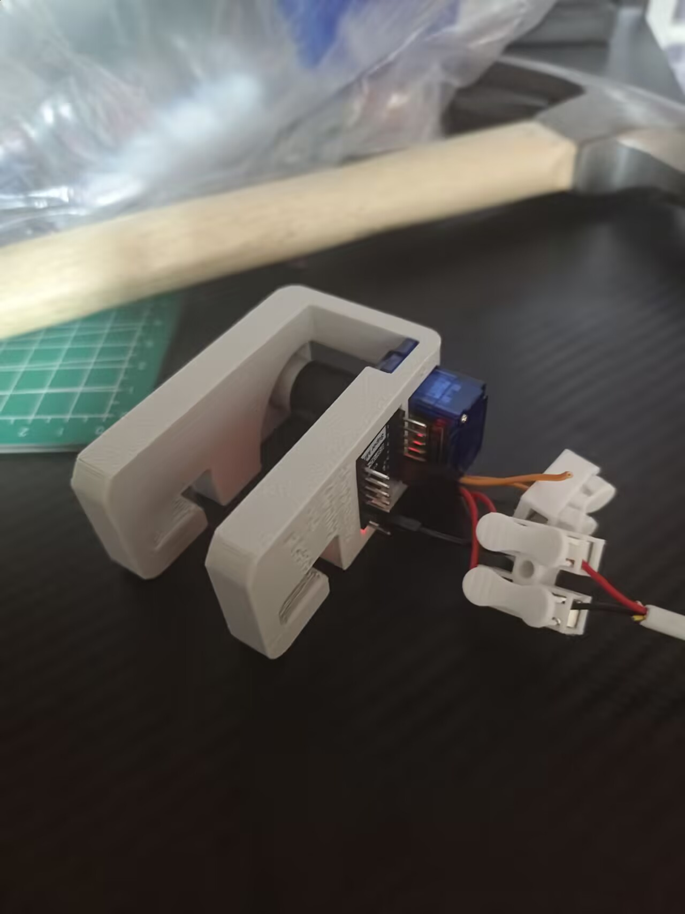
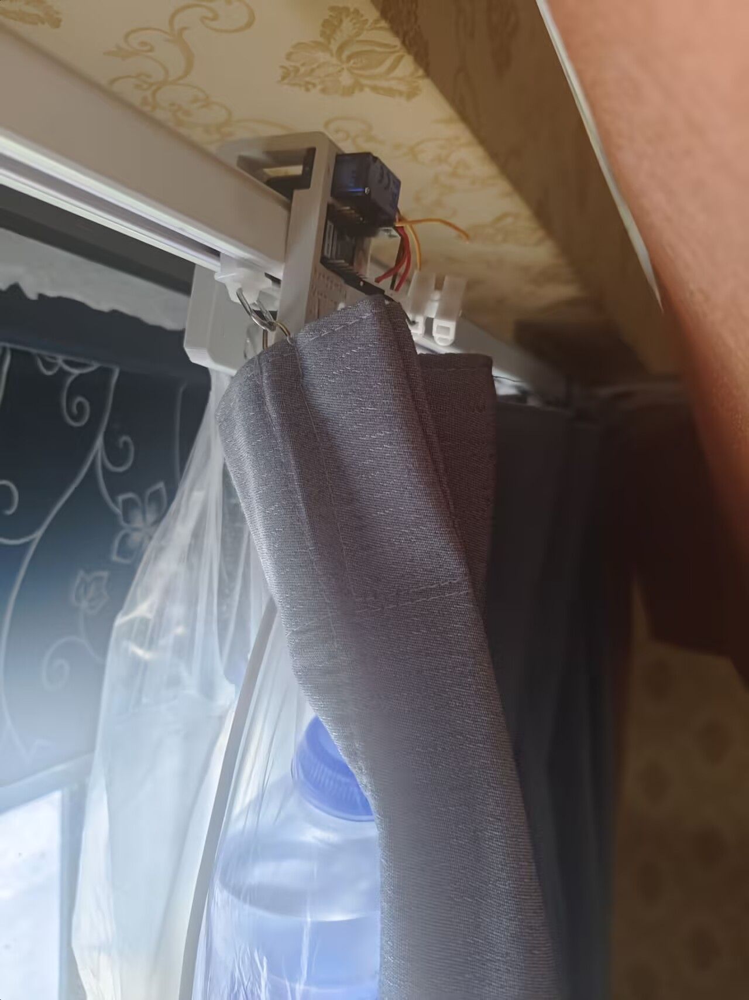
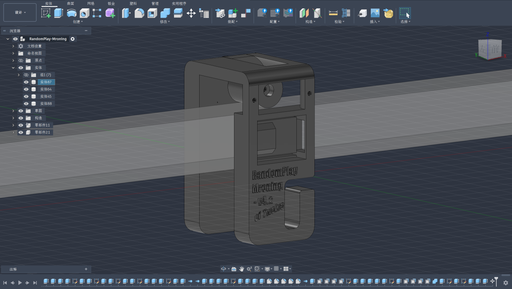
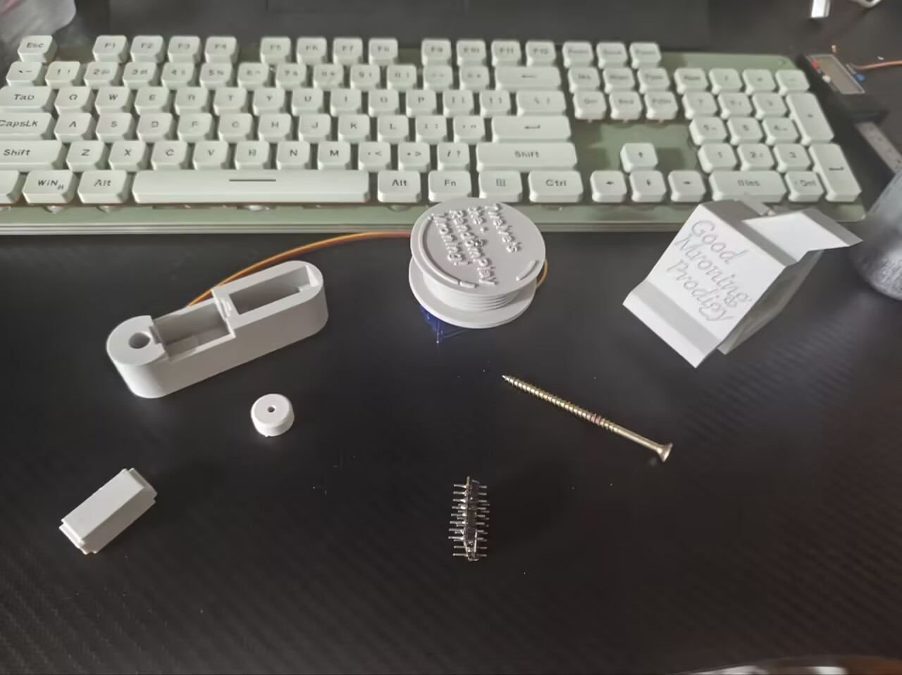
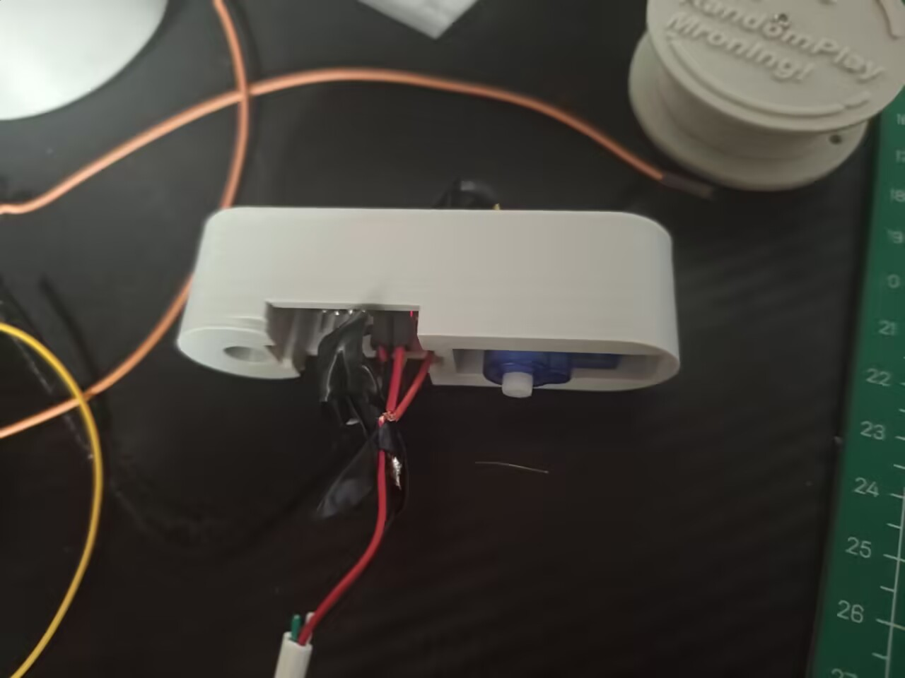
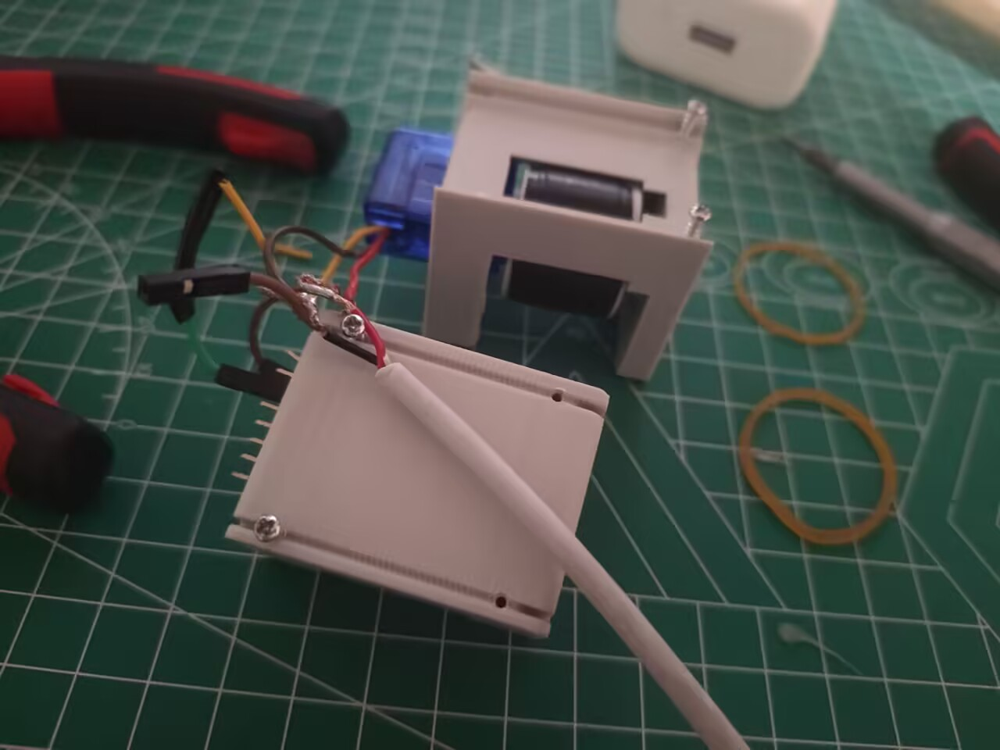
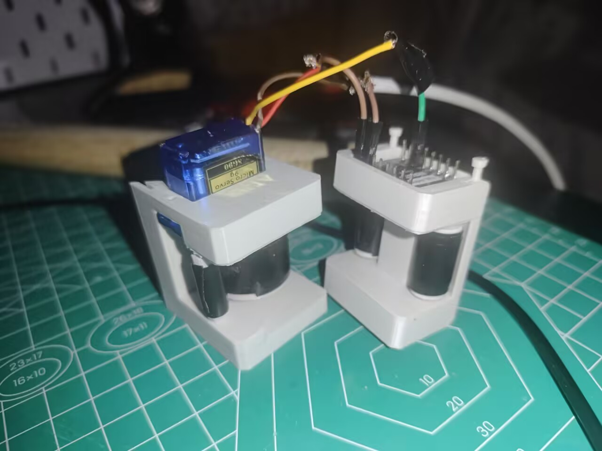
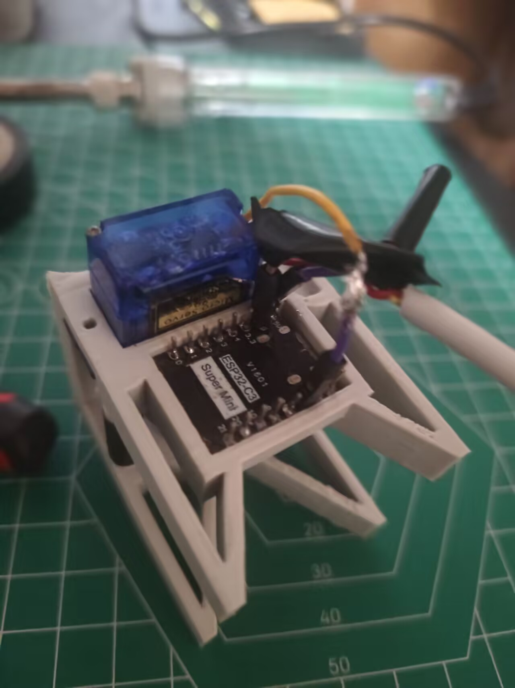

# ￥17低成本自动窗帘机项目，RandomPlay-Mroning
> 这是26年暑假我为了调节作息做的自动窗帘机项目，成本仅17元，研发总成本仅40元

## 3D模型展示

- 适配23mm以内宽的方形窗帘轨道
    - 如需适配更宽或圆轨则需自行修改建模

- 使用M2 20mm螺丝钉对轮子进行固定

- 在轮子上粘一圈胶带增加摩擦力

- 挂一个塑料袋，里面放上配重物体（如矿泉水）

- 建议使用深色耗材打印，或提前使用胶带避免ESP32电源指示LED光污染
## 硬件连接
### 杜邦线连接
| SG90 | ESP32 |
|:-----|-----:|
|PWM|GPIO7|
|VCC|5V|
|GND|GND|

- 准备ESP32-C3-SuperMini开发板 和 360度版本SG90舵机，切勿买成180度版本
- 插入ESP32的C口供电 
- 实物图版本与此仓库上传版本不一致，请以此仓库文档为准

## 软件说明
> 度数映射到360度舵机上为旋转方向与速度

>> 小于90度为顺时针旋转，越趋近0度越快

>> 大于90度为逆时针旋转，越趋近180度越快

>> 90度为完全静止
### ESPHome版本（仓库下esphome-randmron.yaml文件）
> 需先安装Home Assistant及其插件ESPHome

- 在"开启窗帘"与"关闭窗帘"按钮组件根据自己需要调整

### Arduino版本（仓库下arduino-randmron文件夹）
- 通过BLE协议与硬件通讯
> 调试阶段可使用nRF Connect软件连接控制
#### BLE控制语法
- 即时控制：R+映射度数+持续时间
>> 如R180 5000（逆时针最快速度旋转持续5000ms）
- 设置持续状态：D+映射度数
>> 如D180（持续以逆时针最快速度旋转）
- 定时任务：M+时间+映射度数+持续时间
>> 如M1145 180 5000（在下一个11:45时逆时针最快速度旋转持续5000ms）

>>一次性任务，执行后第二天不再执行
- 校准时间：T+年月日时分
>> 如T2603261145（校准当前时间为2026.03.26 11:45）
- 删除定时任务：S+时间
>> 如S1145（删除11:45的定时任务）

---

老大我们这么努力的写开源文档真的有人复刻吗

以下是一些无用的研发经历描述
这个暑假的8月，我刚放弃我的一代外置绳驱灵巧手项目，原因是结构建模过于复杂，算法过于抽象。我开始打算调节作息，所以需要一个自动窗帘机

于是我首先提出RandomPlay DIY智能家居系列计划，并开始研发这个系列的第一个项目：窗帘机RandomPlay-Mronng

我选择DIY而不是购买成品或使用现成开源项目的原因是市面上的窗帘机普遍价格在￥70左右，而开源项目寥寥无几并且多数很贵、很石、很复杂

v1我把设备挂在墙上，用电机旋转带动收紧鱼线去拉开窗帘，失败原因是鱼线容易打结或卡住电机

v2我把设备挂在窗帘轨道上，用橡皮筋使轮子紧贴轨道有足够摩擦力，但发现拓补学问题，橡皮筋没法套住设备，于是我通过打钉子暂时作为补丁修复了这个问题。

v2到这里还有问题，设备在轨道上跑不动，我认为是下半部分没有轮子导致的，于是v3在下半部分也加了轮子，顺便彻底修好了橡皮筋套不上的问题

但我发现仍然跑不动，我认为是橡皮筋太紧的的原因，于是v4我去掉了上下部分之分，直接挂在轨道上。但又因摩擦力低跑不起来，我额外做了一个补丁结构挂载配重增加摩擦力；又因前后副轮容易作为支点让主轮悬空，所以我去除了所有副轮。到这里已经能用了，但因为不小心烧了一个电机需要重新拆开，索性重新翻了一版（（

v5也就是我最上面放的实物图，去掉副轮，把配重挂钩集成到一起，使得整体耗材最低。但很快发现轮子切向力不足推动窗帘很吃力还有烧电机的风险，于是我把主轮直径改小增加切向力作为补丁直接换了上去，这个版本研发时我还发现接线端子比手动焊接好用多了（（，然后就做出了v5.1，也就是我现在还在用的版本

但又发现明明可以通过C口供电为什么还要多接电线，所以很久之后的今天我为了开源项目把模型改了，做了v5.2，顺便把模型完全适配了小直径轮子，便是现在上传的这个仓库版本了

研发中炸了一块开发板和俩舵机还有一堆打印模型，研发成本加上成品成本共40元，因为有pdd优惠劵（）我将贯彻穷鬼命途

暑假内我接触到HA后又扩展研发了RandomPlay这个智能家居系列的几个项目，IR＆RF收发器、插销门锁控制器、RF遥控器桥接ESP32。后续这个系列还有部署在本地服务器上的房间内语音控制agent间接控制HA相关软件项目，可能会用现成项目也可能会自己研发。上述这些后续可能也会陆续开源到github上。

v5.2 260904